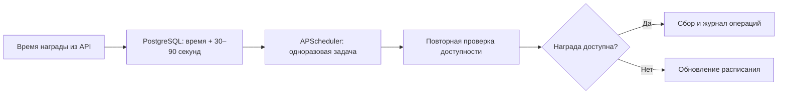

<div align="center">

# Yandex Market Farmer

**Доступные награды Маркета — под управлением личного Telegram-бота.**

[](LICENSE)


[Быстрый старт](#быстрый-старт) · [Установка на VPS](docs/deployment.md) · [Документация](docs/README.md) · [Разработка](CONTRIBUTING.md)

</div>

> [!WARNING]
> Неофициальный проект, созданный исключительно в ознакомительных и исследовательских целях.
> Не связан с Яндексом и не одобрен им. Используется на ваш риск и предоставляется «как есть»,
> без гарантий работоспособности, начисления наград или сохранности аккаунта.
> В пределах, допускаемых применимым законодательством, авторы и участники не несут ответственности
> за блокировки, утрату данных и наград, финансовые потери и иные последствия использования.
> Вы самостоятельно отвечаете за свои действия и соблюдение правил сервисов.

## Да, это вайбкод

Проект создаётся с активным использованием ИИ (вайбкодинг). Мы этого не скрываем:
ИИ помогает писать код, тесты и документацию, а поведение проверяется тестами и запусками владельца.
Это не означает отсутствия ошибок и не заменяет проверку перед использованием на своём аккаунте.
[Что проверено на самом деле →](docs/validation.md)

## Возможности

| | Что умеет бот |
|---|---|
| 🔑 Вход | QR или ссылка Яндекса; без передачи пароля и cookies в чат |
| 👤 Аккаунты | Добавление, переименование, переподключение и удаление с подтверждением |
| 🪙 Баланс | Обновление баланса, история операций и статистика |
| 🕓 Daily | Ручной сбор и автосбор по времени следующей награды из API |
| 🎮 Игры | Отдельный ручной сбор уже заработанных игровых наград |
| 🔔 Контроль | Уведомления, остановка при истёкшей сессии или неопределённом результате |
| 🔒 Доступ | Только личный чат и один разрешённый Telegram user ID |

Меню работает через inline-кнопки с экраном загрузки и защитой от повторных нажатий.
Бот использует long polling: публичный домен, HTTPS-сертификат и webhook не нужны.

> [!IMPORTANT]
> Проект **не вращает рулетку, не тратит монеты, не совершает покупки, не активирует промокоды,
> не подделывает результаты игр и прогресс заданий**. Автоматизации эфиров и обхода CAPTCHA нет.
> Внутренние API Яндекса могут измениться без предупреждения.

## Быстрый старт

Нужны [uv](https://docs.astral.sh/uv/getting-started/installation/), Docker с Compose и `make`.
Команды выполняются из корня клонированного репозитория; Python 3.13 устанавливается через uv при необходимости.

```bash
git clone https://github.com/DOFER998/yandex-market-farmer.git
cd yandex-market-farmer
make sync
make setup-env
make db-up
make start
```

1. `setup-env` запросит токен бота скрытым вводом и ваш числовой Telegram ID, создаст `.env` с правами `600` и случайным паролем БД.
2. `db-up` поднимет PostgreSQL на `127.0.0.1:15432`. Порт меняется через `POSTGRES__PORT` в `.env`.
3. `start` применит миграции и запустит бота. Откройте его в Telegram и нажмите **Начать**.
4. **Добавить аккаунт → Подключение → Войти через QR**. Подтвердите вход в Яндексе, проверьте логин и нажмите **Сохранить вход**.
5. Обновите баланс. При необходимости включите автосбор в настройках аккаунта.

Существующий `.env` команда настройки не перезаписывает. При подключении автосбор сам не включается.
Браузер для QR-входа и работы на VPS не требуется.

<details>
<summary><b>Вход через терминал и резервный браузерный способ</b></summary>

```bash
make login-qr                    # QR прямо в терминале; отдельная новая сессия
make login                      # резервный вход в локальном Chrome/Edge
make account-add ACCOUNT=main SESSION=.secrets/cookies.txt
```

`login-qr` выводит путь к полученному файлу. Для его импорта передайте этот путь в `SESSION`.
Для существующего аккаунта используйте `make account-session`.
Если установленного браузера нет: `uv run --no-sync playwright install chromium`, затем `make login BROWSER=chromium`.
Пароль, 2FA и CAPTCHA вводятся только на стороне Яндекса самим пользователем.

</details>

## Как работает сбор



Daily и игровые награды — независимые операции. Нажатие Daily до окончания таймера
не должно отправлять запрос начисления: доступность проверяется заново.
Расписание восстанавливается из PostgreSQL после перезапуска; Redis не нужен.
Если API не сообщает корректное время, применяется отложенная проверка, а не частый опрос.
Задержка после таймера не гарантирует отсутствие ограничений со стороны сервиса.

## VPS и Docker

Установка одной командой на Ubuntu/Debian **от root** — вручную клонировать репозиторий не нужно:

```bash
bash <(curl -fsSL https://raw.githubusercontent.com/DOFER998/yandex-market-farmer/main/scripts/install.sh)
```

Скрипт получит Compose последнего стабильного релиза, создаст `.env` и каталог сессий,
скачает готовый образ из GHCR и запустит стек. **Исходники, Git и сборка на VPS не нужны.**
На сервере Compose сохраняется как `docker-compose.yml`: команды `docker compose up -d`
и `docker compose logs -f bot` работают без `-f`. Вывод установки компактный,
подробности сохраняются в закрытом логе `/var/log/ymf/`.
Образ поддерживает `linux/amd64` и `linux/arm64`; в `.env` фиксируется точный digest релиза.

[Полная инструкция](docs/deployment.md): установка, управление, обновление и резервные копии.

> [!NOTE]
> QR-вход в боте и чтение API проверены на реальном аккаунте.
> Долговременная работа на VPS и успешное начисление каждой разновидности награды требуют
> отдельной проверки. [Матрица проверок](docs/validation.md) отделяет интеграции от mock-тестов.

## Для разработчиков

```bash
make check                      # Ruff + pytest, без обращений в Маркет и Telegram
make test-postgres              # миграции и блокировки на настоящем PostgreSQL
```

- [Архитектура и границы модулей](docs/server-architecture.md)
- [Исследование API](docs/api-research.md) и [QR-авторизации](docs/bot-auth-research.md)
- [Ветки, CI, образы и релизы](docs/releases.md)
- [Диагностика](docs/research-tools.md) и [безопасность](SECURITY.md)

Исследование протокола опиралось на [xob0t/market-coin-farmer](https://github.com/xob0t/market-coin-farmer)
и QR-поток [AlexxIT/YandexStation](https://github.com/AlexxIT/YandexStation).
Иконки интерфейса — [Telegram iOS Icons](https://t.me/addemoji/tgiosicons).

## Лицензия

[MIT](LICENSE) © 2026 DOFER998 и участники проекта.
[Уведомления о сторонних источниках](THIRD_PARTY_NOTICES.md).
