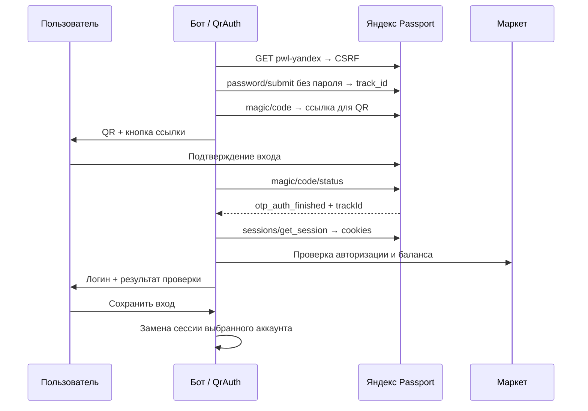

# QR-авторизация

[← Документация](README.md)

## Статус

29.10.2026 владелец подтвердил HTTP-вход через терминал, затем успешный QR-вход из Telegram.
Браузер на сервере не нужен. Это подтверждение для проверенного аккаунта и окружения;
долговременная работа на VPS остаётся отдельной проверкой.

## Основания реализации

[OAuth device flow](https://yandex.com/dev/id/doc/ru/codes/screen-code-oauth) выдаёт OAuth-токен.
Его пригодность для внутренних API монет не установлена: клиент использует web-cookies.
Поэтому реализован Passport QR-поток, исследованный в
[YandexStation get_qr/login_qr](https://github.com/AlexxIT/YandexStation/blob/master/custom_components/yandex_station/core/yandex_session.py#L109-L157).
Это внутренний интерфейс, не публичный стабильный контракт. Credentials чужого OAuth-клиента
и обмен cookies на токен Станции не используются.

## Изоляция и отмена

У каждой попытки отдельный cookie jar, привязка к chat/account/nonce и таймаут 5 минут.
Опрос раз в 5 секунд, HTTP вынесен в thread. Переход в другой раздел отменяет попытку.
После получения готовой сессии даётся ещё 5 минут на сохранение. Старые cookies заменяются
только по кнопке после проверки API; автосбор остаётся выключенным.
Неопределённые результаты прошлых сборов не сбрасываются новым входом.

Редиректы ограничены разрешёнными HTTPS-хостами Яндекса. CAPTCHA и ограничения останавливают
попытку, автоматического обхода нет. HTTP 200 от Passport сам по себе не означает рабочую сессию.
Пароли, OTP и cookies не принимаются в сообщениях бота.

## Терминал

`make login-qr` выводит QR непосредственно в терминал и сохраняет запасную HTML-ссылку
в приватном каталоге. Ctrl+C отменяет ожидание. Только после проверки API записывается новый
`cookies.txt`; сессии уже подключённых аккаунтов не изменяются.
`events.jsonl` содержит этапы, HTTP-коды и имена полей, без значений cookies/CSRF/track/link.

В Telegram QR отправляется как PNG. При возвращении в текстовое меню медиа-сообщение
удаляется и создаётся новое текстовое: активный экран один, но message_id меняется.
Cookies сохраняются из ответов Маркета, однако это не гарантирует бесконечную жизнь сессии.
При её истечении нужен новый вход; OAuth refresh token в этом потоке не используется.
