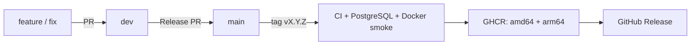

# Ветки, CI и релизы

[← Документация](README.md)

## Ветки



- `dev` — интеграция разработки; каждый push проверяется и публикует тестовый образ `:dev`.
- `main` — стабильный код; изменения приходят через pull request.
- `feature/*`, `fix/*`, `docs/*` — короткоживущие ветки от `dev`.
- `vX.Y.Z` — стабильный релиз; номер обязан совпасть с `project.version` в `pyproject.toml`.

Публикация отклоняет тег вне истории `main`, неправильный формат и несовпадение версии.
Prerelease-теги пока не поддерживаются; тестовые сборки идут через `dev`.

## Что запускается

| Событие | Проверки | Публикация |
|---|---|---|
| PR в `main` / `dev` | Ruff, pytest, PostgreSQL, Compose, Docker smoke | Нет |
| Push в `main` | Те же проверки | Нет |
| Push в `dev` | Те же проверки через reusable CI | `:dev`, `:sha-<full commit>` |
| Push тега `vX.Y.Z` | Валидация тега + те же проверки | `:X.Y.Z`, `:sha-<full commit>`, GitHub Release |

[ci.yml](../.github/workflows/ci.yml) не требует реальных токенов: PostgreSQL — одноразовый
service container, внешние API в тестах подменены. Docker smoke проверяет non-root,
импорты runtime, создание PNG QR, отсутствие Playwright и доступность миграций.
ARM64 собирается при публикации через QEMU; отдельного полного запуска бота на ARM в CI нет.

[publish.yml](../.github/workflows/publish.yml) запускает reusable CI перед публикацией.
Только job публикации получает `packages: write`, только создание Release — `contents: write`.
Pull request не получает эти права. Docker-образ содержит SBOM и provenance; используются
официальные Docker Actions. GitHub Release создаётся после публикации образа и содержит его digest.
К Release прикрепляются `docker-compose.prod.yml` и `image.ref` (образ с digest).
Установщик скачивает только эти файлы; исходники на VPS не нужны.
При повторном запуске существующие release notes и deployment assets сохраняются. Теги релизов нельзя перемещать:
повторная сборка того же тега может дать другой digest из-за обновлённого базового образа.

`latest` и плавающие major/minor теги намеренно отсутствуют. Новый стабильный GitHub Release помечается latest для установщика. Не выпускайте старые версии
после более новых без пересмотра этого правила: latest должен указывать на актуальный стабильный релиз.

## Настройка репозитория один раз

1. Создайте и отправьте `main` и `dev`. Назначьте `main` основной веткой.
2. В Rulesets защитите `main` и `dev`: изменения через PR, запрет force push и удаления.
3. После первого CI включите обязательные проверки `Python and PostgreSQL` и `Docker smoke test`
   (выберите фактические названия в GitHub UI; у reusable workflow может быть префикс).
4. Защитите теги `v*` от изменения и удаления; ограничьте создание релизов maintainer-ами.
5. Разрешите GitHub Actions публикацию packages в настройках организации, если она ограничена.
6. После первой публикации сделайте GHCR package публичным, если установка должна работать без login.

Достаточно встроенного `GITHUB_TOKEN`; PAT и секреты Telegram/Яндекса в CI добавлять не нужно.
Rulesets и настройки GHCR не задаются YAML-файлами проекта: их применяет владелец GitHub-репозитория.

## Выпуск версии

В `dev` обновите `project.version`, выполните `uv lock`, добавьте заметку в `CHANGELOG.md`,
проверьте `make check` и откройте PR `dev → main`. После merge и зелёного CI:

```bash
git switch main
git pull --ff-only origin main
# Пример: версия в pyproject.toml уже равна 0.1.0.
git tag -a v0.1.0 -m 'Release 0.1.0'
git push origin v0.1.0
```

Publish создаст образ и Release с автоматически собранными заметками из PR.
Для следующей версии замените номер в примере. Не создавайте один и тот же тег повторно.
При ошибке сборки исправьте проблему и повторите job, либо выпускайте новый номер, если меняется код.
Workflow не обновляет VPS: используйте установщик или команды Compose из [инструкции](deployment.md).

## Проверенные версии инструментов

Сверены по официальным релизам 29.10.2026; Actions закреплены полным commit SHA.

| Инструмент | Версия | Источник |
|---|---|---|
| checkout | 7.0.1 | [Release](https://github.com/actions/checkout/releases/tag/v7.0.1) |
| setup-uv | 10.3.2 | [Release](https://github.com/astral-sh/setup-uv/releases/tag/v10.3.2) |
| uv, CI и Docker | 0.13.5 | [Release](https://github.com/astral-sh/uv/releases/tag/0.13.5) |
| build-push-action | 7.4.0 | [Release](https://github.com/docker/build-push-action/releases/tag/v7.4.0) |
| login-action | 4.7.0 | [Release](https://github.com/docker/login-action/releases/tag/v4.7.0) |
| setup-buildx-action | 4.4.1 | [Release](https://github.com/docker/setup-buildx-action/releases/tag/v4.4.1) |
| setup-qemu-action | 4.4.0 | [Release](https://github.com/docker/setup-qemu-action/releases/tag/v4.4.0) |
| metadata-action | 6.2.0 | [Release](https://github.com/docker/metadata-action/releases/tag/v6.2.0) |

Python остаётся в ветке `3.13`, Debian — `bookworm`, PostgreSQL — `17`.
Patch-версии базовых образов обновляются при сборке; Python-зависимости фиксирует `uv.lock`.
Для повторяемого развёртывания уже собранного образа используйте digest.
Dependabot еженедельно предлагает обновления Actions и Docker в `dev`.
Обновления Python-зависимостей делаются через `uv lock --upgrade` отдельным PR с полным CI.
