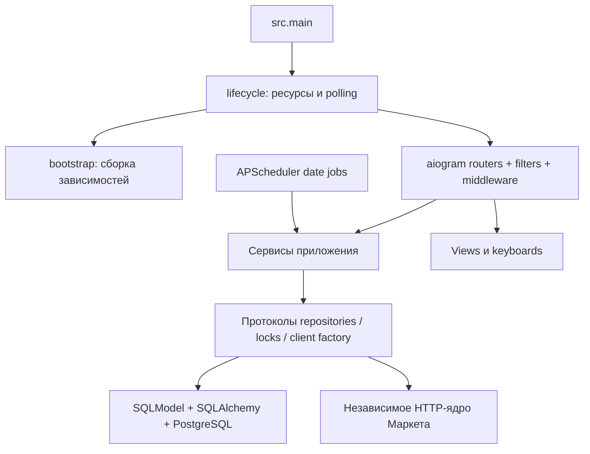

# Архитектура

[← Документация](README.md)

Проект запускается из исходников: `src/` содержит модули непосредственно, без вложенного
пакета с названием приложения. Точка входа — `python -m src.main`. Настройки читаются из `.env`
при старте, зависимости создаются в composition root и передаются явно.

## Модули

| Каталог / файл | Ответственность |
|---|---|
| `src/main.py` | Запуск event loop, обработка завершения |
| `src/lifecycle.py` | Время жизни polling, scheduler, QR-попыток и heartbeat |
| `src/bootstrap.py` | Создание engine, репозиториев, блокировок и сервисов |
| `src/common/config/` | Pydantic Settings и секции вложенных переменных `.env` |
| `src/routers/private/` | Обработчики сообщений и callback, aiogram DI |
| `src/filters/` | Два ограничения: личный чат и ID владельца |
| `src/middlewares/` | Изоляция навигации, активные операции, обработка ошибок |
| `src/services/` | Сценарии приложения и протоколы зависимостей |
| `src/database/` | SQLModel-модели, репозитории, транзакции и PostgreSQL-блокировки |
| `src/market/` | HTTP, cookies, авторизация, проверенные контракты наград |
| `src/views/`, `src/keyboards/` | HTML-текст и inline-кнопки |
| `src/callback_data/`, `src/states/` | Типизированные действия и FSM |
| `migrations/` | Alembic-миграции |
| `scripts/` | Настройка окружения, healthcheck, импорт и диагностика |

Сервисы получают конкретные зависимости через конструкторы, не используют `Database` как
service locator. SQLModel-модели служат общими сущностями; дополнительного дублирования
ORM/domain-моделей нет. SQLAlchemy sessions и запросы остаются внутри репозиториев.

## Сбор и согласованность

`FarmingService` берёт account lock, проверяет прерванные операции, создаёт запуск и вызывает
`FarmingWorker`. `OperationJournal` фиксирует намерение до запроса и результат после него.
Синхронный HTTP выполняется в thread; сохранение журнала возвращается в async loop.
При отмене задачи блокировка остаётся удержанной до завершения worker.

Daily и игры имеют независимые сценарии. Daily повторно проверяет доступность перед начислением.
Планировщик запускает только daily; игры собираются отдельным ручным действием.
Неизвестный результат изменяющего запроса блокирует дальнейший автоматический сбор до проверки.

PostgreSQL advisory locks защищают аккаунты между процессами, asyncio locks — внутри процесса.
Отдельный PostgreSQL lock допускает только один polling-процесс на БД. Разные БД эту защиту не разделяют.

Расписание хранится в PostgreSQL: время API плюс сохранённая задержка 30–90 секунд.
APScheduler восстанавливает одноразовые date-задачи при старте. Изменения аккаунта через очередь
переназначают задачи. Redis и постоянный interval-поллинг Маркета не нужны.

## Авторизация и интерфейс

`QrLoginService` держит временные QR-попытки в памяти; `QrAuth` выполняет HTTP-протокол отдельно
от Telegram. Новая сессия проверяется API и заменяет старую только после подтверждения пользователя.
`AccountService` отвечает за сохранение сессий, настройки, имена, удаление и чтение истории.

Оба фильтра действуют на сообщения и callback. Роутеры не выполняют SQL; результаты передаются
в views/keyboards. `ScreenService` контролирует активное сообщение и ревизию экрана, чтобы
завершившаяся фоновая задача не затёрла более новую навигацию. Во время изменяющих операций
показывается загрузка, повторные нажатия не ставятся в очередь.

## Логирование и транспорт

Loguru настраивается централизованно, stdlib logging библиотек перенаправлен в него.
Логи содержат этапы и классы ошибок без cookies, токенов, raw-ответов и traceback locals.
Диагностические скрипты могут выдавать JSON в stdout; подробные приватные отчёты лежат в `.secrets`.

`src/market` не зависит от Telegram, PostgreSQL и APScheduler. Транспорт — curl_cffi с браузерным
TLS/HTTP-профилем по результатам [исследования](api-research.md), без обхода CAPTCHA.
Playwright используется только для резервного локального входа и исследования; в Docker runtime
его зависимости нет. Инструменты эфиров не участвуют в серверном сборе.
